# Departures card

Home Assistant dashboard card for the next departures from stops, railway stations and airports, from any sensor in
the departures format.

[![GitHub Release][releases-shield]][releases] [![GitHub Release Date][release-date-shield]][releases] [![Downloads][downloads-shield]][releases] [![Marketplace][marketplace-shield]][marketplace] [![License][license-shield]](LICENSE)

<p>
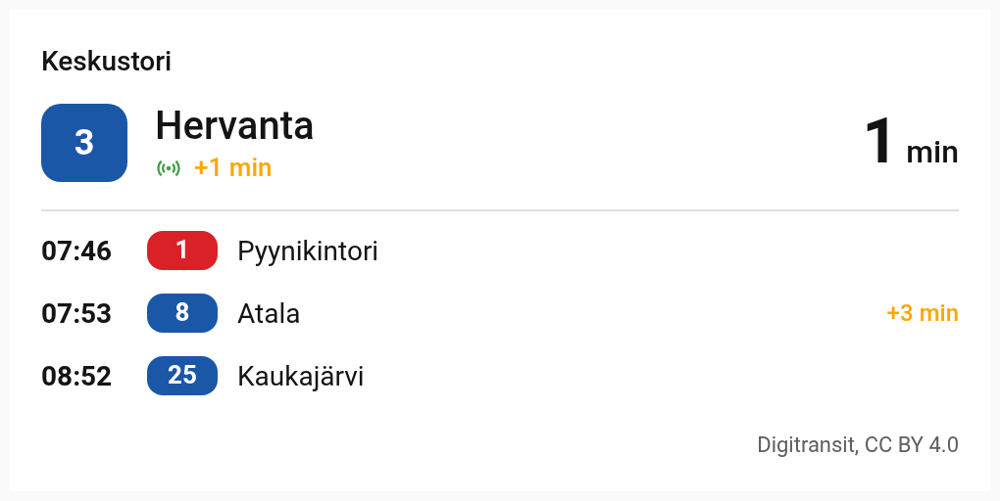
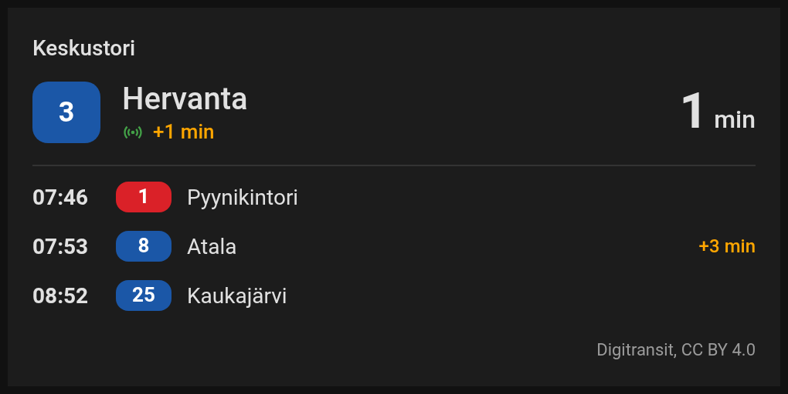
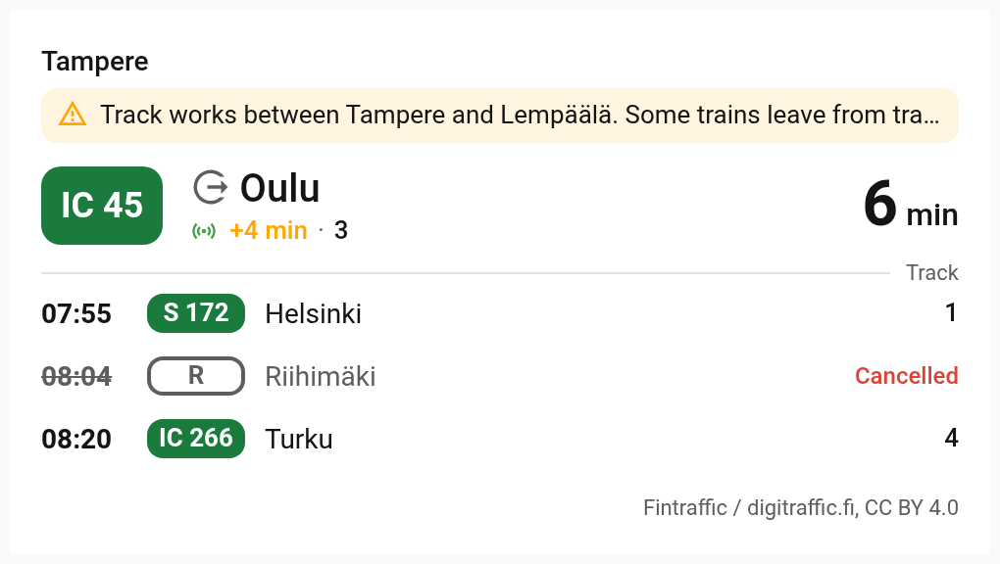
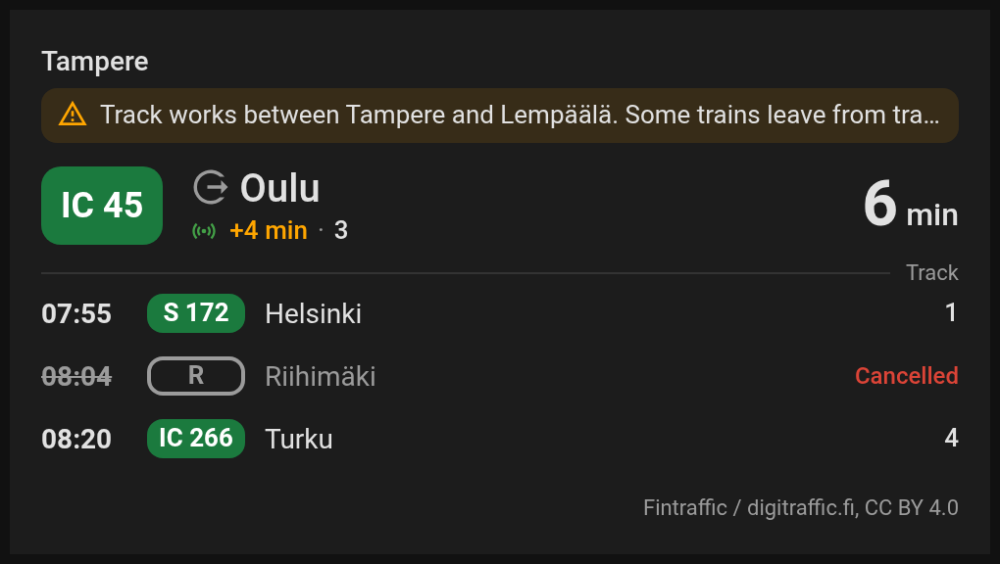
</p>

## What is it?

A custom card that shows when the next bus, tram, train or flight leaves, or the next train or flight comes in. Each stop is a
section of its own, with the next departure large, its line, destination and a countdown, and the ones after it as rows
below. Several stops fit in one card, such as both sides of a street or an airport's departures and arrivals. They sit
side by side when the card is wide enough, or make one list by time.

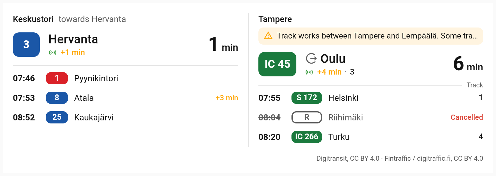
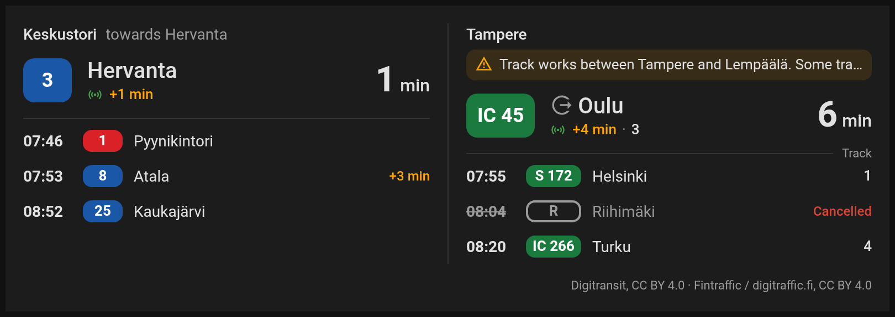

The card reads sensors in the [departures format](docs/departures-format.md), so it works with any integration that
writes it:

- [Digitransit Live](https://github.com/jesmak/digitransit_live): bus, tram and metro stops anywhere in Finland.
- [Digitraffic Live](https://github.com/jesmak/digitraffic_live): departures and arrivals at Finnish railway stations,
  the departures optionally only the trains that stop at another station later, such as Helsinki → Tampere.
- [Finavia Flights](https://github.com/jesmak/finavia_flights): departures and arrivals at Finavia's airports in
  Finland.

Integrations that write the format carry the GitHub topic
[`departures-card-source`](https://github.com/topics/departures-card-source), so that's where to look for more. If
you make one, give its repository the topic too. A template entity can write the format as well.

## Installation

### With the Marketplace

1. Open Settings › Marketplace and search for Departures card
2. Open it and choose Install
3. Refresh your browser

### Manual

1. Take `dist/departures-card.js` from the source code of the [latest release][releases] and copy it to the
   `config/www` folder of your Home Assistant installation
2. In Home Assistant settings, open dashboards, click the three dots at the top right and open resources
3. Add a new resource with the path `/local/departures-card.js` and type JavaScript
4. Refresh your browser

## Options

| Name               | Type    | Description                                                                                                                                                                                                                                                        | Default                                                                         |
| ------------------ | ------- | ------------------------------------------------------------------------------------------------------------------------------------------------------------------------------------------------------------------------------------------------------------------ | ------------------------------------------------------------------------------- |
| `type`             | string  | `custom:departures-card`                                                                                                                                                                                                                                           | required                                                                        |
| `entities`         | list    | Departures sensors, each shown as a section or all as one list with `combine`, as an entity id or one with its heading                                                                                                                                             | required                                                                        |
| `title`            | string  | Shown at the top of the card                                                                                                                                                                                                                                       |                                                                                 |
| `departures`       | number  | How many departures each stop shows, or the whole list with `combine`, the large one, cancelled ones and up to two arrivals that are over included                                                                                                                 | `4`                                                                             |
| `show_cancelled`   | boolean | Show cancelled departures, struck through                                                                                                                                                                                                                          | `true`                                                                          |
| `show_notices`     | boolean | Show the stop's notices, such as track works, under its name                                                                                                                                                                                                       | `true`                                                                          |
| `full_texts`       | boolean | Show every text the card would otherwise cut short in full                                                                                                                                                                                                         | `false`                                                                         |
| `combine`          | boolean | Show every stop's departures and arrivals as one list by time, not a section each                                                                                                                                                                                  | `false`                                                                         |
| `height_mode`      | string  | How tall the card is. `auto` fits its content, `fixed` keeps it at `height`, `max` lets it grow up to `max_height`. In `fixed` and `max` the later departures scroll. A height in grid rows, set in the layout tab of a sections view, is used instead             | `fixed` when `height` is set, `max` when only `max_height` is, otherwise `auto` |
| `height`           | number  | The card's height in pixels, for `fixed`                                                                                                                                                                                                                           |                                                                                 |
| `max_height`       | number  | The card's greatest height in pixels, for `max`                                                                                                                                                                                                                    |                                                                                 |
| `row_step`         | string  | How the card rounds its height on automatic rows in a sections view, with `height_mode` `auto` or `max`. `full` rounds up to whole rows, `half` to half rows, which saves space but may leave the cards under it half a row off the rows of the sections beside it | `full`                                                                          |
| `scroll_indicator` | string  | How a stop's departures show that there are more when they scroll in a card held to a height. `both` fades the edges where the list runs on and shows a thin scrollbar, `fade` only fades the edges, `scrollbar` only shows the scrollbar                          | `both`                                                                          |

Each item of `entities` is an entity id, or an object with these keys:

| Name       | Type   | Description                                                                          |
| ---------- | ------ | ------------------------------------------------------------------------------------ |
| `entity`   | string | The departures sensor                                                                |
| `name`     | string | Replaces the stop's own name. Both sides of a street usually share one               |
| `subtitle` | string | A quieter second part of the heading, such as the direction. Not used with `combine` |

Every option can be set in the card's visual editor, except `height_mode`, `height` and `max_height`, which are set in
YAML. In a sections view the layout tab sets the card's height. They are for where there is no layout tab, such as a
masonry or panel view, or a stack or other card the card is inside, even in a sections view.

## What it shows

- **How soon it leaves:** "now" under a minute, minutes under an hour, and the clock time after that. A time that
  isn't today has its weekday in front ("Mon 06:15"), and one a week or more away its date. The countdown runs on
  between the sensor's updates, and a departure more than a minute gone is hidden.
- **Live times:** the large departure has a live icon when it is tracked in real time, and says "On time" when its
  estimate is its timetable time. A departure that is late or early shows its estimate, with the difference in minutes
  at the end of its line.
- **Details in a popup:** a departure's line shows only what matters at a glance. Clicking it opens a popup with the
  rest, which is its timetable time and estimate, its track or gate by name, its notice in full, and whether it is
  cancelled or has come in, in the same colours as on the card. Its close button, a click on the same line, a click elsewhere or Esc closes it.
- **The line's colour**, when the integration gives one, otherwise a colour by vehicle type.
- **The vehicle type's icon** in the badge of a line that has no number or name of its own, such as a rural bus
  route known only by its stops.
- **Track, platform, gate or berth:** a train's track, a plane's gate, a ship's or ferry's berth, or another vehicle's
  platform, when the stop has them, as its number at the end of the line. What the number is, such as Track or Gate,
  is said once, at the end of the divider above the later departures. An arriving plane's is its area, such as
  a baggage hall.
- **Cancellations:** a cancelled departure stays in the list, greyed and struck through, and says so at the end of its
  line. The reason is in its popup when the integration gives one. It is counted in the number of departures, so the list is as long whatever is cancelled. It is
  never the large one, which is always the next departure you can actually take, even when a run of cancellations
  comes before it.
- **Arrivals:** a sensor that lists arrivals is headed "Arrivals", and one that says it lists departures "Departures".
  An arrival stays for half an hour after its time, and one that has come in shows when, dimmed, with its delay. A plane
  or train that has come in has a green icon, and its popup says it has landed or arrived. The latest two that are over, come in or cancelled and past their time, are
  listed after the large one within the number of departures, so the list is as long whatever has come in. The large
  one is the next arrival still to come.
- **Which way it goes:** a plane's or a train's large departure or arrival has an icon in front of its destination or
  origin, a plane's takeoff or landing and a train's exit or entry door. In one list of both directions (`combine`),
  every departure and arrival has one, so they can be told apart. Buses, ships and the rest get the door there too.
- **Notices:** a notice about the departure itself, such as "Passengers are directed to train S 106", is in its popup.
  Its line tells of it with its direction icon in the theme's accent colour, or with an info sign where it has no such
  icon. The stop's own notices, such as track works with buses replacing trains, are each on a line of its own under
  its name. One cut short shows in full when the mouse is over it.

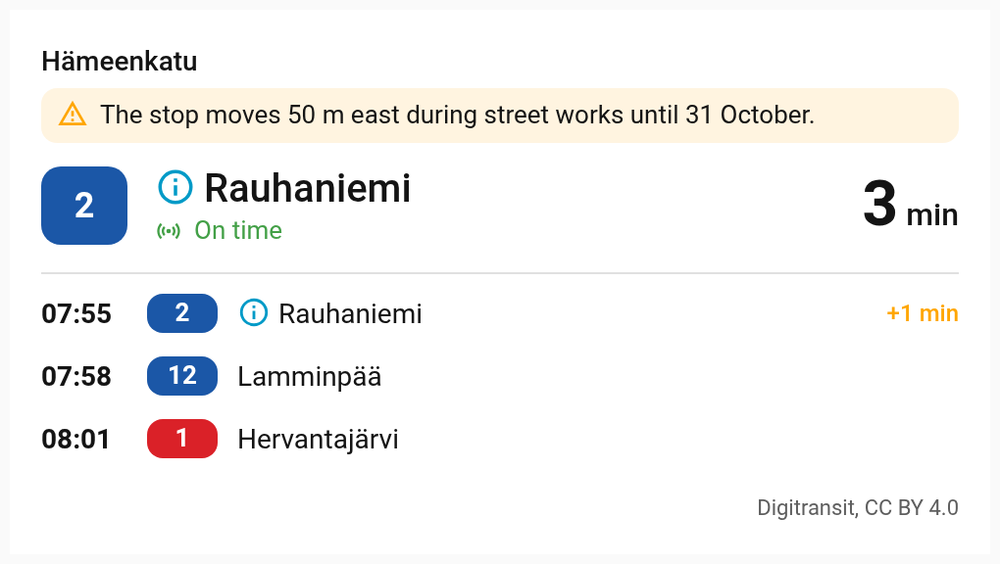
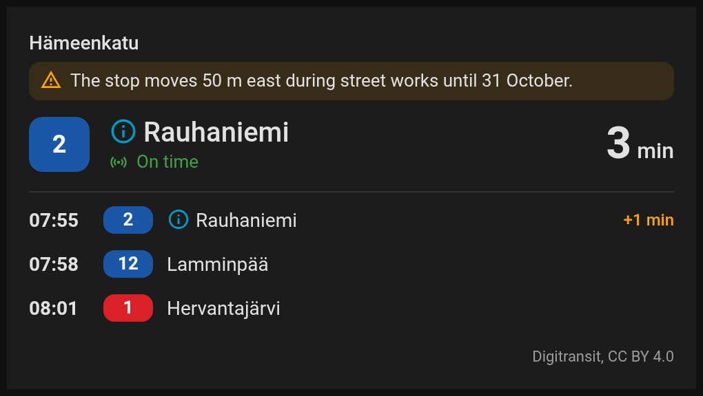

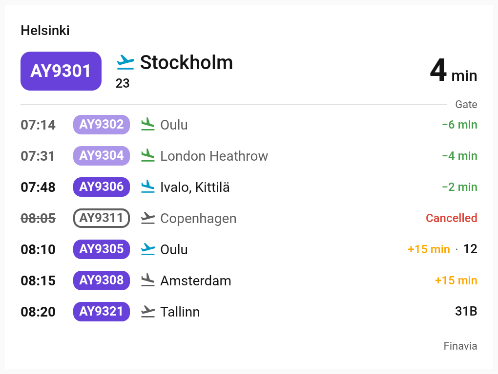
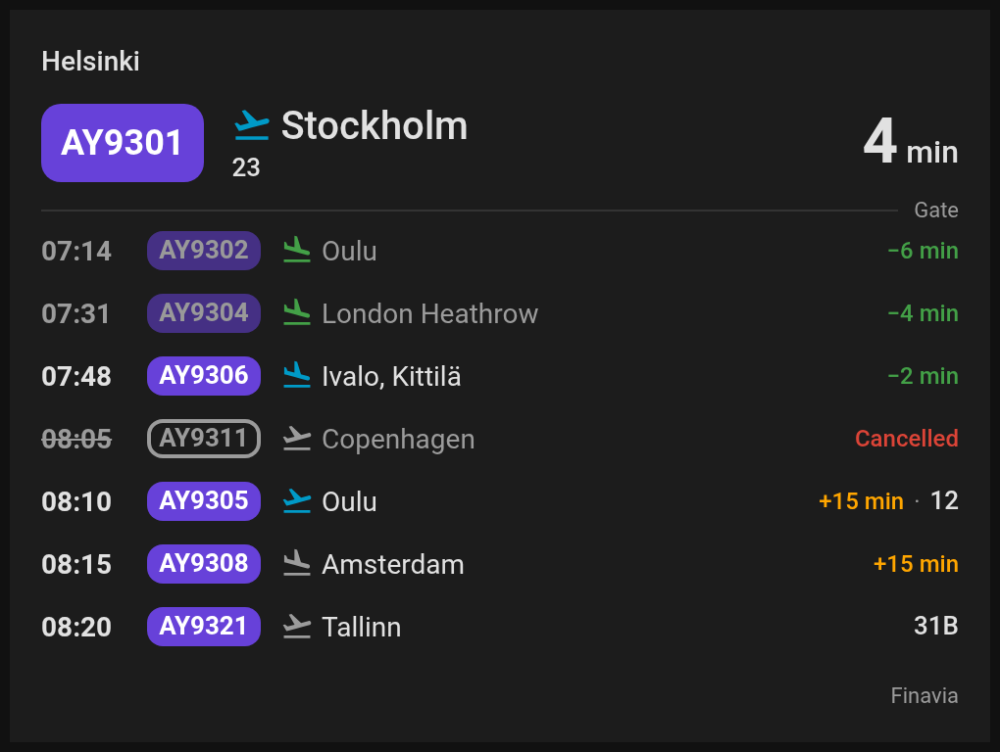

Clicking a stop's name opens its sensor. With `combine` the heading names every stop it shows once, with their direction
when they all have the same one, and opens the first of them. A stop that can't be shown has a line of its own saying
why.

## Sizes

In a sections view the card takes a whole section and can't be made narrower, 320 px at its least. Two stops sit side
by side once the card is 620 px wide. With `combine` they are one list at any width. The stop's name wraps rather than
being cut, unless the card is held to a height without `full_texts`, and so does a line known by a long name rather
than a number, inside its badge. Times, delays, tracks, platforms and gates are never cut.

A departure is always one line, so the card's height comes from how many departures it shows and never from what they
say. A destination that doesn't fit is cut short, as are the subtitle and the stop's notices. A text cut short shows in
full when the mouse is over it, and a departure's popup has its destination in full.

Set `full_texts: true` to show them in full. A destination that doesn't fit beside the rest of its line then takes the
next line whole, so a departure's height can change with its destination, and on automatic rows the card can take a row
more or less as the departures change.

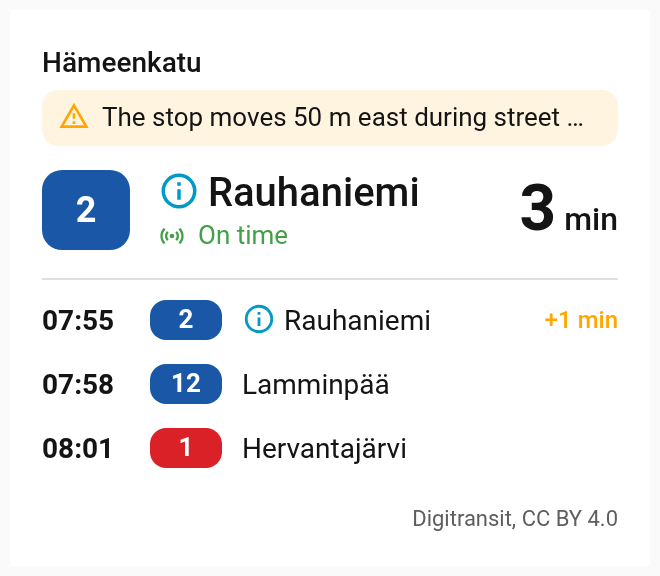
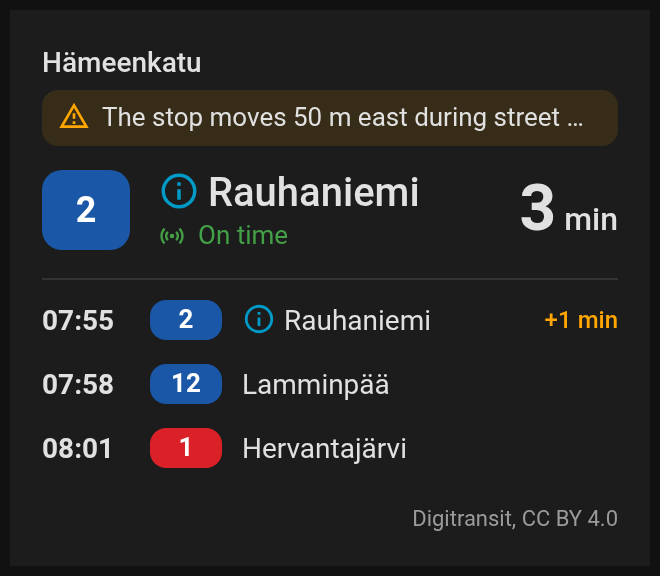

Held to a height, the card keeps its title, its attribution and each stop's name and subtitle to one line, cut short
with an ellipsis when they are longer, unless `full_texts` shows them in full. The least it gets keeps every stop's
next departure and the first departure after it in view. It counts the stops one above
the other, unless the card has 24 columns or more in a sections view, which keep it at least 620 px wide wherever its
section sits beside others, so its stops always sit in pairs side by side there. On a phone, where the section takes the
screen's width, such a card's stops go one above the other again, and those that don't fit the rows set for it scroll. A stop's notices, texts shown in full,
the line about a sensor that can't be shown and a long line name wrapping on a card inside another card, narrower than
a section allows, take room of their own, and the later departures scroll under them.

The card's parts are sized in half rows of a sections view. A stop with four departures takes four rows, and two more
departures take one more row. A title or a stop's notice takes half a row, as does each departure, and a stop under
another leaves half a row. On automatic rows the card ends on a whole row, with any half row left over under the title,
or at the top without one. With `row_step: half` it ends on the half row its parts end on. With `max_height`, it grows
the same way up to that height rounded down to its rows, so it stays on the rows when it reaches it too.

In the `fixed` and `max` height modes, or with a number of rows given to the card in a sections view, the title, the
data's attribution and each stop's name, notices and next departure stay where they are, and only the stop's later
departures scroll. The stops share the height, and a `fixed` height or `max` limit is never lower than what every stop's
next departure and one departure after it need.

## Colours

The vehicle types' colours can be changed in a theme:

| Variable                   | Default   |
| -------------------------- | --------- |
| `--departures-bus-color`   | `#0b6aa2` |
| `--departures-tram-color`  | `#00845a` |
| `--departures-metro-color` | `#d9480f` |
| `--departures-train-color` | `#1b7a3e` |
| `--departures-ferry-color` | `#00639a` |
| `--departures-ship-color`  | `#0b7285` |
| `--departures-plane-color` | `#6741d9` |
| `--departures-other-color` | `#5f6b76` |

## Examples

### One stop

```yaml
type: custom:departures-card
entities:
  - sensor.kauppatori_h0453
```

### Both sides of a street

```yaml
type: custom:departures-card
title: Next buses
departures: 5
entities:
  - entity: sensor.mannerheimintie_h1234
    name: Mannerheimintie
    subtitle: towards the centre
  - entity: sensor.mannerheimintie_h1235
    name: Mannerheimintie
    subtitle: away from the centre
```

### Trains both ways between two cities

Two Digitraffic Live station departure sensors, one in each direction with the other city as its "stops at" station.

```yaml
type: custom:departures-card
entities:
  - entity: sensor.trains_helsinki_tampere
    subtitle: to Tampere
  - entity: sensor.trains_tampere_helsinki
    subtitle: to Helsinki
```

### An airport both ways in one list

Finavia Flights' departures and arrivals sensors for one airport, merged by time, each flight marked with whether it
leaves or lands.

```yaml
type: custom:departures-card
combine: true
departures: 10
entities:
  - sensor.helsinki
  - sensor.helsinki_arrivals
```

## Upgrading from 1.x

Nothing needs changing in the card's configuration. Three things look different:

- A card set narrower than a whole section in a sections view is widened to one, as the card's least width is now 12
  columns.
- A departure's notice, the word for one that has landed or arrived and its timetable time have moved from its line
  to its popup.
- A card held to a height can be given fewer rows than before, as a departure no longer needs room for a second line.

## Data

The departures come from the sensors the card is given. The card itself fetches nothing.

The [departures format](docs/departures-format.md) describes the sensor the card reads, with its attributes,
each departure's fields, how the card shows them, and the rules for sources. An integration that writes it gets the card
for free, and the format is meant to stay stable. New optional fields are added without changing its version.

## Translating

The card's texts are in `src/localize/languages/`, one JSON file per language, named by its language code, such as
`en.json` and `fi.json`. To add a language, copy `en.json` to the new language's code, such as `sv.json`, and translate
the values. A file may name a region, such as `pt-br.json`. It is used for `pt-BR`, falling back to a file for the
language alone (`pt.json`), and then to English. Nothing else needs changing. The card finds the file by itself and
uses it when Home Assistant is set to that language. A text left out falls back to English. Names, destinations and
notices come from the integrations, in the language they were set up with.

## Development

Requires Node 22.13 or newer.

```
npm install
npm run check
```

`npm run check` typechecks, lints, checks formatting, runs the tests and builds `dist/departures-card.js`, which is
the file the Marketplace installs and is committed to the repository.

| Path                        | What it contains                                           |
| --------------------------- | ---------------------------------------------------------- |
| `src/departures-card.ts`    | The card itself                                            |
| `src/editor.ts`             | The visual editor                                          |
| `src/departures.ts`         | Reading the sensors, and the times, days and colours shown |
| `src/height.ts`             | The height modes and the height they give the card         |
| `src/rows.ts`               | Filling whole or half rows in a sections view              |
| `src/fade.ts`               | The fades at the edges of a scrolling list                 |
| `src/localize/languages/`   | The card's texts, one JSON file per language               |
| `docs/departures-format.md` | The format the card reads                                  |
| `docs/screenshots.json`     | The made-up data the README's screenshots are taken from   |
| `tests/`                    | Tests, run with vitest                                     |

## Contributing

Pull requests are welcome. Open them against the `dev` branch, where the work for the next release is collected.
`main` holds the latest release and moves only when a new one is made, so this README always describes the released
version.

## Support

Hey dude! Help me out for a couple of :beers: or a :coffee:!

[](https://www.buymeacoffee.com/jesmak)

## License

MIT, see [LICENSE](LICENSE).

[releases-shield]: https://img.shields.io/github/release/jesmak/departures-card.svg?style=for-the-badge
[release-date-shield]: https://img.shields.io/github/release-date/jesmak/departures-card?style=for-the-badge
[releases]: https://github.com/jesmak/departures-card/releases
[downloads-shield]: https://img.shields.io/github/downloads/jesmak/departures-card/total.svg?style=for-the-badge
[marketplace-shield]: https://img.shields.io/badge/Marketplace-Default-green.svg?style=for-the-badge
[marketplace]: https://my.home-assistant.io/redirect/marketplace_repository/?owner=jesmak&repository=departures-card&category=plugin
[license-shield]: https://img.shields.io/github/license/jesmak/departures-card.svg?style=for-the-badge
